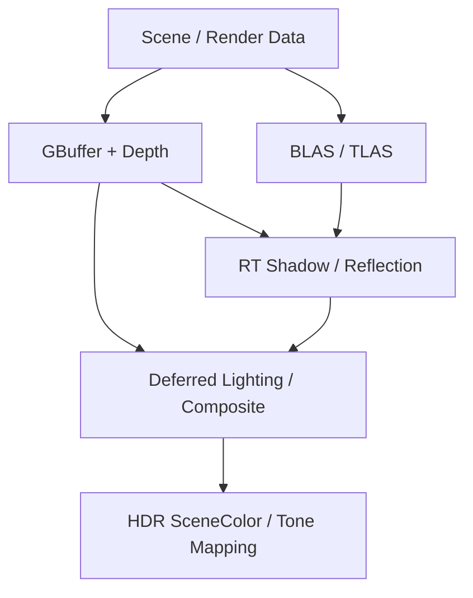

# DirectX 12 Custom Renderer

DirectX 12 기반의 실시간 렌더러를 직접 구현하며 GPU 파이프라인, Resource 관리, Deferred Rendering, RenderGraph, 그리고 DXR까지 단계적으로 학습하기 위한 개인 프로젝트입니다.

단순히 화면에 오브젝트를 출력하는 것을 목표로 하지 않고, CPU에서 생성된 데이터가 GPU Resource로 전달되고 여러 Render Pass를 거쳐 최종 픽셀로 출력되기까지의 흐름을 직접 구현하면서 현대 렌더링 엔진의 구조를 이해하는 것을 목표로 합니다.

> 기준일: 2026-10-15. Raster Deferred 기반과 DXR의 BLAS/TLAS, State Object, SBT, 카메라 Ray Generation, 텍스처 기반 PBR/Normal Mapping, 불투명 물체의 방향광 Ray-Traced Hard Shadow까지 구현했습니다. 현재는 DXR 전체 화면 출력을 SceneColor에 복사하는 검증 단계이며, GBuffer 기반 Hybrid 합성과 멀티스레드 렌더링은 다음 목표입니다.

**1차 완료 목표: 2026년 11월 30일 — Raster와 DXR을 결합하고, 안전한 멀티스레드 렌더링 구조와 성능 비교를 갖춘 자체 렌더러.**

구현 상태와 향후 계획을 구분해 기록합니다. 아래 완료 표시는 기능 구현 및 개발 중 화면 확인을 의미하며, 모든 입력·장시간 실행·GPU 검증·성능 검증의 완료를 뜻하지 않습니다. 정량 성능 결과는 측정 후 별도로 기록할 예정입니다.

---

## Goals

이 프로젝트에서 중점적으로 학습하고 있는 내용은 다음과 같습니다.

- DirectX 12의 명시적인 GPU Resource / Descriptor / Synchronization 모델
- CPU Scene 데이터와 GPU Draw 데이터의 분리
- Material / Texture / Mesh Asset Pipeline
- Deferred Rendering과 GBuffer 구성
- Shadow Mapping과 PBR Lighting
- HDR Intermediate Render Target과 Tone Mapping
- Render Pass 간 Resource State 관리
- RenderGraph를 이용한 Pass Dependency 분석과 실행 순서 계산
- DXR의 BLAS / TLAS / Ray Generation / Hit / Miss Pipeline
- 1차 완료 범위인 Render Thread / Worker Thread 기반 병렬 Command Recording

---

## Current Rendering Pipeline

현재 프레임은 RenderGraph에 다음 Pass를 등록합니다.

| Pass | 주요 입력 | 주요 출력 / 역할 |
|---|---|---|
| GBufferPass | Mesh / Material / Camera | BaseColor, World Normal, Roughness/Metallic, Depth |
| ShadowPass | Mesh / Light | Directional Light Shadow Depth |
| DeferredLightingPass | GBuffer / Depth / Shadow Map | HDR SceneColor |
| RaytracingPass | TLAS / Camera / Material / Light | 카메라 ray 기반 PBR + RT Shadow → RaytracingOutput |
| CopyRaytracingOutput | RaytracingOutput | SceneColor에 DXR 결과 복사 |
| ToneMapping | SceneColor | BackBuffer |

**현재 최종 화면은 DXR 출력입니다.** Raster Deferred 결과도 계산하지만, 이후 `CopyRaytracingOutput`이 SceneColor를 덮어씁니다. 두 경로의 기능을 하나의 최종 조명 결과로 합성한 상태는 아닙니다.

### Target Hybrid Pipeline — Planned



다음 단계에서는 Raster/DXR 비교 모드를 먼저 분리하고, GBuffer의 표면 정보를 이용하는 RT 효과를 Deferred 경로에 합성합니다. 모드별로 필요한 Pass만 실행해 기능 비교와 성능 측정의 기준을 마련할 예정입니다.

---

## DirectX 12 Core

- D3D12 Device / Adapter 초기화
- High Performance GPU Adapter 선택
- Command Queue / Command Allocator / Command List 관리
- Swap Chain / Back Buffer 관리
- RTV / DSV / SRV 생성 및 관리
- Root Signature / Graphics PSO 구성
- Fence 기반 CPU-GPU 동기화
- Triple Buffering 기반 Frame Resource
- Upload Heap → Default Heap Resource Upload
- 명시적인 Resource Barrier 처리
- Shader Visible Descriptor Heap
- Descriptor 연속 할당 지원

### Frame Resource

각 BackBuffer index별로 Frame Resource를 분리해 이전 GPU 작업이 끝나기 전에 같은 Command Allocator / Constant Buffer 영역을 재사용하지 않도록 관리합니다.

```text
FrameResource
 ├─ CommandAllocator
 ├─ FenceValue
 ├─ Object Constant Buffer
 ├─ Scene Constant Buffer
 ├─ Directional Light Constant Buffer
 ├─ Shadow Pass Constant Buffer
 └─ Deferred Pass Constant Buffer
```

---

## Scene / Render Data Architecture

Asset, Instance, Draw 데이터를 분리했습니다.

```text
ModelData
  └─ CPU-side import result

RenderModel
 ├─ Mesh
 ├─ SubMeshes
 ├─ Materials
 └─ BLAS

RenderObject
 ├─ shared_ptr<RenderModel>
 └─ World Transform

Scene
 └─ RenderObject[]

DrawCommand
 ├─ Mesh*
 ├─ Material*
 ├─ IndexStart
 ├─ IndexCount
 └─ ObjectIndex
```

### Ownership

- `RenderModel`은 GPU-ready shared model asset입니다.
- 여러 `RenderObject`가 하나의 `RenderModel`을 공유할 수 있습니다.
- `Mesh`와 BLAS는 `RenderModel`이 `unique_ptr`로 소유합니다.
- 같은 `RenderModel`을 공유하는 Object는 Mesh / Material / BLAS를 공유하고, World Transform은 각자 가집니다.
- Pass는 Scene 전체를 직접 해석하지 않고 Frame 시작 시 생성한 `DrawCommand`를 사용해 Draw를 기록합니다.

DXR에서는 RenderModel의 BLAS를 여러 TLAS Instance에서 재사용합니다. 이후 Render Thread에는 프레임 단위 Render Snapshot을 전달하는 구조로 확장할 예정입니다.

### Procedural Model Input

`CreateRenderModel(FilePath)`는 glTF를 CPU `ModelData`로 읽고, `CreateRenderModel(const ModelData&)`가 GPU Mesh / Material / BLAS를 생성합니다. 직접 생성한 Cube Mesh도 같은 GPU 생성 경로를 사용합니다. 업로드의 Begin/End는 공통 GPU 생성 경로에서 관리합니다.

---

## glTF Asset Loading

[cgltf](https://github.com/jkuhlmann/cgltf)를 사용해 glTF 데이터를 내부 Renderer 데이터로 변환합니다.

### Supported Data

- Position
- Normal
- Tangent
- Texcoord
- Index
- Multiple Primitives
- Multiple Materials
- BaseColor Factor
- Roughness Factor
- Metallic Factor
- BaseColor Texture
- Metallic-Roughness Texture
- Normal Texture
- External Image
- BufferView Embedded Image

### Data Flow

```text
glTF
 ↓
cgltf
 ↓
GLTFLoader
 ↓
ModelData
 ├─ MeshData
 ├─ SubMeshData
 └─ MaterialData
 ↓
RenderModel
 ├─ Mesh GPU Resources
 ├─ Materials
 └─ SubMesh Ranges
 ↓
RenderObject
 ↓
Scene
```

### Tangent Generation

glTF에 Tangent Attribute가 없는 경우 Position / UV / Index를 이용해 Triangle별 Tangent와 Bitangent를 계산합니다.

Vertex별 누적 후 Normal에 대해 Gram-Schmidt 직교화를 수행하고 Bitangent 방향을 이용해 Tangent Handedness를 계산합니다.

---

## Texture / Material System

### Texture

- WIC 기반 이미지 로딩
- PNG / JPG 지원
- Embedded glTF Image 로딩
- Upload Heap을 통한 GPU Texture Upload
- SRV 생성
- sRGB / Linear Color Space 구분

Color Space 규칙:

```text
BaseColor            → sRGB
Metallic-Roughness   → Linear
Normal Map           → Linear
```

Fallback Resource:

- White Texture: `(255, 255, 255, 255)`
- Default Normal: `(128, 128, 255, 255)`

### PBR Material

Cook-Torrance BRDF 기반 Metallic-Roughness PBR을 사용합니다.

- Lambert Diffuse
- GGX Normal Distribution Function
- Schlick Fresnel
- Smith Geometry Function
- BaseColor
- Roughness
- Metallic
- Normal Mapping
- Material Constant Buffer

glTF Metallic-Roughness Texture의 packing 규칙을 사용합니다.

```text
G Channel → Roughness
B Channel → Metallic
```

---

## GBuffer Pass

Deferred Rendering을 위해 3개의 MRT와 Depth Buffer를 사용합니다.

```text
GBuffer A : BaseColor
GBuffer B : World Space Normal
GBuffer C : Roughness / Metallic
Depth     : Device Z
```

Material Texture와 Constant Buffer를 GBuffer Pass에서 읽고 Lighting에 필요한 정보를 저장합니다.

---

## Deferred Lighting

GBuffer를 읽는 Fullscreen Triangle Pass로 Lighting을 계산합니다.

입력:

```text
GBuffer A
GBuffer B
GBuffer C
Depth
Directional Light
Shadow Map
Camera Position
Inverse ViewProjection
```

Depth를 이용해 World Position을 복원하고, Directional Light와 Cook-Torrance BRDF를 이용해 HDR SceneColor에 결과를 출력합니다.

```text
GBuffer + Depth
      ↓
World Position Reconstruction
      ↓
PBR Lighting
      ↓
Shadow Factor
      ↓
HDR SceneColor
```

---

## Directional Light Shadow Mapping

Directional Light 기준 Depth를 별도의 Shadow Map에 기록합니다.

- Shadow Map Resolution: 2048 × 2048
- Orthographic Light Projection
- Depth Bias
- 3 × 3 PCF

```text
World Position
     ↓
Light ViewProjection
     ↓
Shadow UV / Current Depth
     ↓
Shadow Map Compare
     ↓
Shadow Factor
```

Shadow는 현재 direct lighting에 적용하고 ambient term에는 적용하지 않습니다.

---

## HDR SceneColor / Tone Mapping

Deferred Lighting 결과를 BackBuffer에 바로 쓰지 않고 HDR Intermediate Render Target에 저장합니다.

```text
GBuffer
  ↓
Deferred Lighting
  ↓
SceneColor : R16G16B16A16_FLOAT
  ↓
Tone Mapping
  ↓
BackBuffer : R8G8B8A8_UNORM
```

Tone Mapping Pass는 Fullscreen Triangle을 사용하며 Exposure Root Constant를 전달하고 ACES 계열 tone mapping과 Linear → sRGB 변환을 수행합니다.

---

## Resource State Tracker

Pass마다 Resource Barrier를 수동으로 배치하던 구조에서 Resource의 현재 상태를 중앙에서 추적하는 구조로 변경했습니다.

```text
Pass
 ↓
Required Resource State
 ↓
ResourceStateTracker
 ↓
Current State 비교
 ↓
필요한 경우 D3D12_RESOURCE_BARRIER 기록
```

현재 추적 대상:

- GBuffer A / B / C
- Main Depth
- Shadow Depth
- SceneColor
- RaytracingOutput (UAV / Copy Source)

BackBuffer의 PRESENT ↔ RENDER_TARGET 전환은 현재 Tone Mapping Pass 내부에서 처리합니다.

---

## RenderGraph

Render Pass가 자신이 사용하는 Resource와 Access 유형을 선언하도록 구성했습니다.

```cpp
enum class RenderGraphAccess
{
    Read,
    Write,
    ReadWrite
};
```

각 Pass는 다음 정보를 가집니다.

```text
RenderGraphPass
 ├─ Name
 ├─ ResourceUsages
 ├─ Dependencies
 └─ Execute
```

Resource Usage는 다음 정보를 표현합니다.

```text
Resource
RequiredState
Read / Write / ReadWrite
```

### Dependency Analysis

같은 Resource를 사용하는 Pass들에 대해 다음 hazard를 기준으로 dependency를 생성합니다.

```text
Read  → Read   : Dependency 없음
Write → Read   : RAW
Read  → Write  : WAR
Write → Write  : WAW
```

Raster 경로의 주요 dependency는 다음 형태입니다. 현재 전체 프레임에는 앞서 설명한 RaytracingPass / CopyRaytracingOutput도 포함됩니다.

```text
GBuffer ───────────┐
                   ▼
                Deferred ─────→ ToneMapping
                   ▲
                   │
Shadow ────────────┘
```

GBuffer와 Shadow는 서로 다른 Resource를 Write하므로 직접적인 dependency가 없습니다.

### Topological Sort

Dependency를 이용해 각 Pass의 indegree를 계산하고 Kahn Algorithm으로 실행 순서를 생성합니다.

```text
Dependencies
     ↓
Indegree 계산
     ↓
Indegree == 0인 Pass Queue 삽입
     ↓
Pass 처리
     ↓
해당 Pass를 기다리는 Pass들의 Indegree 감소
     ↓
새롭게 0이 된 Pass Queue 삽입
     ↓
ExecutionOrder
```

`RenderGraph::Execute()`는 AddPass 순서가 아니라 계산된 `ExecutionOrder`를 따라 Pass를 실행합니다.

현재 RenderGraph는 학습 목적의 최소 구현이며, 향후 다음 기능으로 확장할 예정입니다.

- Logical Resource / Resource Version
- Pass Culling
- Transient Resource
- Resource Lifetime
- Barrier Batching
- Parallel Command Recording
- Async Compute / Multi Queue Scheduling

---

## DXR Progress

### Implemented

- Ray Tracing Tier 확인 및 `ID3D12Device5` / `ID3D12GraphicsCommandList4` 확보
- Mesh의 Vertex / Index Buffer와 Submesh 범위로 BLAS 생성
- RenderObject의 World Transform을 TLAS Instance에 반영
- DXIL Library / State Object / Global·Local Root Signature 구성
- Ray Generation / Miss / Closest Hit Shader 및 `DispatchRays()`
- 카메라 상수 버퍼와 inverse view-projection을 이용한 primary ray 생성
- Triangle index fetch 및 barycentric 기반 UV / Normal / Tangent 보간
- BaseColor / Metallic-Roughness / Normal Texture 연결
- Cook-Torrance PBR 및 월드 공간 TBN 기반 Normal Mapping
- Shadow Payload와 별도 Shadow Hit/Miss 경로
- Geometric normal 기반 origin offset 및 불투명 방향광 hard shadow
- 프레임별 Hit Table, 공통 Miss Table, HDR DXR 출력과 Tone Mapping 연결

### Binding Layout

| 범위 | HLSL binding | 전달 방식 |
|---|---|---|
| Global | t0 TLAS, u0 Output | Descriptor Table |
| Global | b0 Camera, b1 Light | Root CBV / GPU VA |
| Global | s0 MaterialSampler | Linear/Wrap Static Sampler |
| Local — Camera Hit Group | t1 Vertex, t2 Index | Root SRV / GPU VA |
| Local — Camera Hit Group | b2 Material | Root CBV / GPU VA |
| Local — Camera Hit Group | t3 BaseColor, t4 MR, t5 Normal | 개별 Descriptor Table / GPU Descriptor Handle |

Texture SRV는 개별 할당되므로, 각각 descriptor 1개를 가리키는 table을 사용합니다.

### Shader Binding Table

서브메시마다 카메라용 / Shadow용 record를 연속 배치합니다.

| Record | 내용 |
|---|---|
| Geometry 0 / Camera | HitGroup Identifier + Vertex VA + Index VA + Material VA + Texture Handle 3개 |
| Geometry 0 / Shadow | ShadowHitGroup Identifier |
| Geometry 1 / Camera | 다음 Geometry의 재질·메시 인자 |
| Geometry 1 / Shadow | ShadowHitGroup Identifier |

- Camera record: Identifier 32 + Local Arguments 48 = 80바이트, 정렬 후 **96바이트**.
- Shadow record: Identifier 32바이트만 사용하며, 같은 Hit Table의 **96바이트 stride**를 공유합니다.
- Miss Table: `Miss` / `ShadowMiss` 두 record, 각 32바이트, 총 64바이트.
- 카메라 TraceRay 선택값: ray offset 0 / geometry multiplier 2 / miss index 0.
- Shadow TraceRay 선택값: ray offset 1 / geometry multiplier 2 / miss index 1.
- TLAS instance offset은 이전 Object들의 서브메시 수 × 2만큼 누적합니다.

```text
HitRecordIndex = InstanceOffset + GeometryIndex × GeometryMultiplier + RayOffset
```

### Ray-Traced Shadow

`ClosestHit`에서 표면으로부터 빛 방향으로 Shadow Ray를 발사합니다.

- 삼각형 위치에서 구한 geometric normal로 시작점 offset 방향 선택
- 현재 origin bias / TMin: 각각 0.001 월드 단위
- TMax: 10000 월드 단위
- `RAY_FLAG_ACCEPT_FIRST_HIT_AND_END_SEARCH` 사용
- Shadow hit는 Occluded = 1, miss는 0 기록
- 최종 색: `Ambient + DirectLighting × (1 - Occluded)`
- Camera Ray 안에서 Shadow Ray를 호출하므로 최대 추적 깊이는 2

Bias와 검사 거리는 현재 테스트 Scene 기준의 실험값이며, 모든 크기의 장면에 대한 보장값은 아닙니다.

### Current Limitations

- BLAS geometry는 불투명으로 취급합니다. Alpha Mask / 투명 재질의 그림자는 미지원입니다.
- TLAS와 Hit Table은 첫 프레임의 초기화 경로에서 생성합니다. 런타임 Object 이동·추가·삭제에 대한 갱신은 아직 구현하지 않았습니다.
- Texture는 현재 단일 mip과 `SampleLevel(..., 0)`을 사용합니다.
- 반사 / RTAO / 시간 누적 / denoising은 미구현입니다.
- Render Thread와 Worker Thread를 분리하지 않았습니다.
- RenderGraph는 기존 Resource의 의존성과 실행 순서를 다루는 최소 구현입니다. Transient 할당·Pass Culling·병렬 스케줄링은 미구현입니다.

---

## Validation Scene

현재 Scene에는 AK 모델 Instance 두 개와 직접 생성한 회색 바닥·큐브를 배치했습니다.

| 대상 | 구성 | 확인 목적 |
|---|---|---|
| glTF 모델 | 같은 RenderModel을 공유하는 Instance 두 개 | Texture / Submesh / Instance / SBT 선택 |
| 바닥 | Cube Scale (32, 0.1, 32), Position (0, -0.05, 0) | Y=0의 그림자 수신면 |
| 큐브 | Cube Scale (2, 2, 2), Position (0, 1, 0) | 바닥 접촉과 hard shadow |
| 바닥·큐브 재질 | BaseColor (0.5, 0.5, 0.5), Roughness 0.7, Metallic 0 | 텍스처 무늬와 분리한 조명 확인 |

Camera와 방향광 조건을 고정해 Raster / Hybrid 및 기능 ON/OFF를 비교할 예정입니다. Worker 성능 측정에는 별도로 Object / Draw 수를 늘린 부하 Scene을 사용합니다.

---

## Project Structure

```text
DX12CustomRenderer/
 ├─ Application
 ├─ WindowsWindow
 │
 ├─ D3D12Device
 ├─ D3D12CommandQueue
 ├─ D3D12CommandContext
 ├─ D3D12SwapChain
 ├─ D3D12DescriptorAllocator
 ├─ D3D12ResourceUploader
 ├─ D3D12ResourceStateTracker
 │
 ├─ Renderer
 ├─ RenderGraph
 ├─ Scene
 ├─ RenderObject
 ├─ RenderModel
 ├─ AccelerationStructure
 ├─ GeometryGenerator
 ├─ DrawCommand
 │
 ├─ Mesh
 ├─ Material
 ├─ Texture
 │
 ├─ GLTFLoader
 ├─ ImageLoader
 │
 ├─ GBuffer Shader
 ├─ Shadow Shader
 ├─ Deferred Lighting Shader
 ├─ Tone Mapping Shader
 └─ Raytracing.hlsl
```

---

## What I Learned

현재까지 직접 구현하며 학습한 핵심 내용입니다.

- DirectX 12에서 Device / Queue / Allocator / Command List의 역할
- Fence를 이용한 CPU-GPU 동기화
- Triple Buffered Frame Resource
- Upload Heap과 Default Heap의 차이
- Descriptor Heap과 Root Signature
- Texture의 sRGB / Linear 처리
- glTF Mesh / Primitive / Material 구조
- Tangent Space와 Normal Mapping
- Cook-Torrance PBR
- Directional Light Shadow Mapping
- PCF
- MRT 기반 GBuffer
- Device Z에서 World Position 복원
- Deferred Lighting
- HDR Intermediate Render Target
- Tone Mapping
- Scene / RenderModel / RenderObject 역할 분리
- Scene 데이터에서 DrawCommand 생성
- Resource State 추적
- Render Pass Resource Usage 선언
- RAW / WAR / WAW Data Hazard
- DAG / Indegree / Topological Sort
- Kahn Algorithm
- RenderGraph Dependency 기반 실행
- COM QueryInterface와 D3D12 확장 Interface
- BLAS / TLAS와 모델 공유·Instance Transform
- DXIL Export / State Object / Hit Group / Root Signature Association
- SBT 정렬과 record index 계산
- GPU VA와 GPU Descriptor Handle의 역할 차이
- DXR의 barycentric 보간·TBN·Texture Sampling
- Primary Ray와 Shadow Ray의 payload / hit / miss 분리
- Geometric Normal과 Shading Normal의 역할 차이
- Shadow Bias, Visibility, 중첩 TraceRay 깊이

---

## Roadmap

### Implemented Foundation

- [x] DirectX 12 Core / 프레임별 Fence·Constant Buffer
- [x] Mesh / Texture / Material / glTF Loading
- [x] Metallic-Roughness PBR / Normal Mapping
- [x] Shadow Mapping / GBuffer / Deferred Lighting
- [x] HDR SceneColor / Tone Mapping
- [x] Scene / RenderObject / RenderModel / DrawCommand 분리
- [x] ResourceStateTracker / 최소 RenderGraph / Dependency Analysis / Topological Sort
- [x] DXR Capability / BLAS / TLAS
- [x] RayGen / Miss / ClosestHit / State Object / SBT / DispatchRays
- [x] DXR Texture 기반 PBR / Normal Mapping
- [x] 불투명 방향광 Ray-Traced Hard Shadow
- [x] Procedural Model 입력 / 바닥·큐브 검증 Scene

### Required for the First Release — 2026-11-30 Target

- [ ] Raster / DXR 비교 모드와 필요한 Pass만 실행하는 경로
- [ ] GBuffer 기반 RT Shadow와 Deferred Lighting 통합
- [ ] Shadow Map / RT Shadow 및 기능 ON/OFF 비교
- [ ] 1회 Ray-Traced Reflection과 Hybrid 합성
- [ ] Reflection 품질에 필요한 최소 누적·필터링
- [ ] 동적 입력 변경 시 필요한 TLAS / SBT 갱신과 안전한 수명 관리
- [ ] Main Thread / Render Thread 분리
- [ ] 프레임 단위 불변 Render Snapshot 전달
- [ ] Worker Thread Pool / GBuffer 병렬 Command Recording
- [ ] Worker별·Frame별 Command Allocator / Command List
- [ ] CPU 작업 완료와 GPU Fence 완료를 구분한 재사용·종료 처리
- [ ] 단일 / 멀티스레드 결과·성능 비교
- [ ] 데모 / 영상 / 구조도 / 제약 및 측정 결과 문서화

### First Release Schedule

기간은 **2026년**, 목표 완료일은 **11월 30일**입니다. 주당 약 10~15시간의 학습·구현을 가정한 계획이며, 완료 보장이 아닌 진행 관리 기준입니다.

| 기간 | 목표 | 완료 기준 |
|---|---|---|
| 10/16~10/18 | Raster / DXR 모드 분리·기준 화면 확보 | 동일 Scene 출력 비교, 불필요한 경로 실행 제외 |
| 10/19~10/25 | RT Shadow의 Deferred 통합 | GBuffer 기반 검사·합성, Shadow Map / RT Shadow 비교 |
| 10/26~11/1 | 1회 Reflection 구현·합성 | 매끄러운 표면에 다른 물체 반사, 카메라 이동 반영 |
| 11/2~11/8 | 렌더링 안정화·스레딩 준비 | 기본 반사 품질, 프레임 입력·자원 소유권·수명 정리, CPU 기준 시간 확보 |
| 11/9~11/15 | Main / Render Thread 분리 | 불변 Snapshot 전달, 프레임 제한·안전한 종료 동기화 |
| 11/16~11/22 | Worker 병렬 Command Recording | Worker/Frame별 allocator·list, draw 분할·제출·재사용 |
| 11/23~11/26 | 정확성·성능 검증·수정 | 단일/멀티스레드 비교, 작업량별 CPU/GPU 비용 기록 |
| 11/27~11/30 | 지연 대응·최종 정리 | 실행 데모, 영상, README, 구조도와 측정 결과 |

### Multithreaded Rendering Completion Criteria

단순히 렌더 함수를 다른 스레드에서 호출하는 것을 완료로 보지 않습니다.

1. Main Thread는 Scene을 갱신하고, Render Thread에는 프레임 단위의 불변 Snapshot을 전달합니다.
2. Snapshot이 참조하는 GPU Asset의 수명을 유지하며, 소비 중인 프레임 데이터를 덮어쓰지 않습니다.
3. Render Thread는 프레임을 준비하고, Worker들은 우선 GBuffer draw recording을 분담합니다.
4. 각 Worker는 Frame별 allocator / list를 사용하고 필요한 상태·바인딩을 자기 list에 기록합니다.
5. CPU Worker 완료 후 Command List를 의존 순서에 맞춰 제출합니다.
6. GPU가 사용하는 allocator / upload memory / descriptor는 해당 Fence 완료 전에 재사용·해제하지 않습니다.
7. 단일/멀티스레드 모드에서 결과가 일치하고, 종료 시 진행 중인 작업을 안전하게 정리합니다.
8. 적은 draw와 많은 draw에서 모두 측정해 작업 분배 비용과 이득을 기록합니다. 속도 향상은 측정 전제이며 보장하지 않습니다.

### Scope Control

- 매끄러운 표면의 1회 Reflection을 우선 완성합니다.
- 확률적 샘플링을 도입해 노이즈가 생기는 범위에 맞춰 누적·필터링을 적용합니다. 매끄러운 반사에 시간 누적을 무조건 추가하지 않습니다.
- 병렬화는 우선 GBuffer recording으로 한정합니다. Shadow Pass 확장은 여유 시간에 검토합니다.
- 정확성·동기화 검증 시간을 유지하고, 지연 시 시각적 확장부터 축소합니다.

### After the First Release

- RTAO / Soft Shadow / 거친 반사 / 다중 반사
- 고급 Temporal Reprojection / Denoising
- IBL 및 확장된 재질·환경 조명
- Logical RenderGraph Resource / Resource Version / Pass Culling
- Transient Resource / Aliasing / Barrier Batching
- Async Compute / Multi Queue Scheduling
- 광범위한 glTF·재질 지원과 Asset Pipeline 개선

---

## Development Direction

최종 목표는 특정 DirectX 12 API 호출을 암기하는 것이 아니라 다음과 같은 렌더링 엔진의 핵심 문제를 직접 해결해보는 것입니다.

```text
Scene
 ↓
Render Data
 ↓
Draw / Ray Tracing Commands
 ↓
RenderGraph
 ↓
Resource / Dependency / Scheduling
 ↓
D3D12
 ↓
GPU
```

Raster Deferred Renderer를 기반으로 RenderGraph와 DXR을 결합한 Hybrid Renderer로 확장하고, Render Thread와 Worker Thread를 분리해 실제 엔진에 가까운 멀티스레드 렌더링 구조를 구현합니다.

1차 결과물은 기능 목록뿐 아니라 **데이터 흐름, Ownership/Lifetime, CPU/GPU 동기화, 병렬화의 정확성과 측정된 비용**을 설명할 수 있는 형태로 정리합니다.
